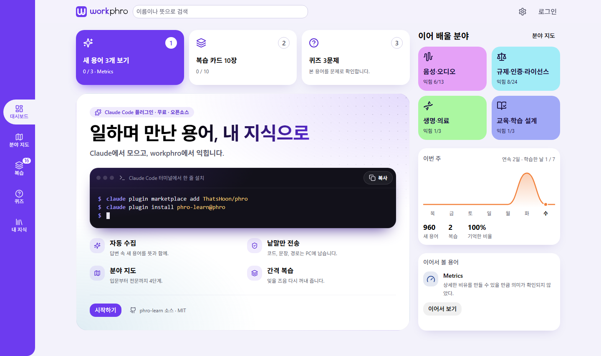
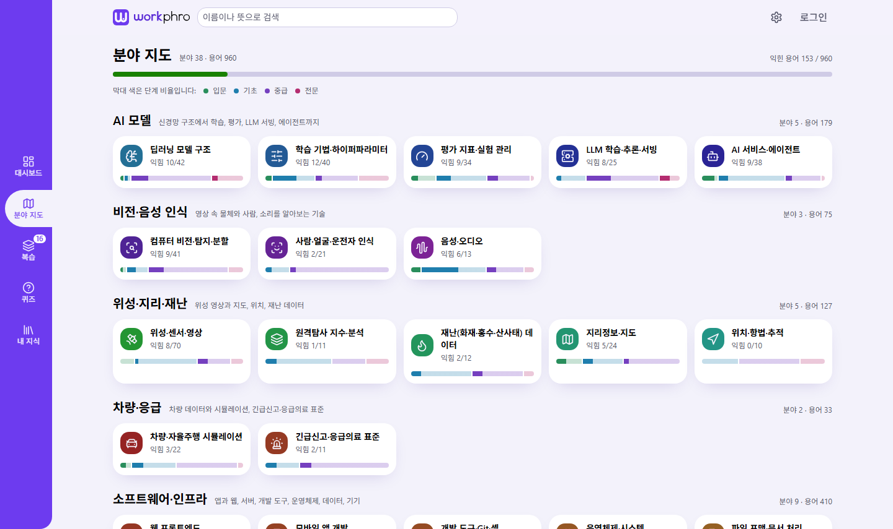
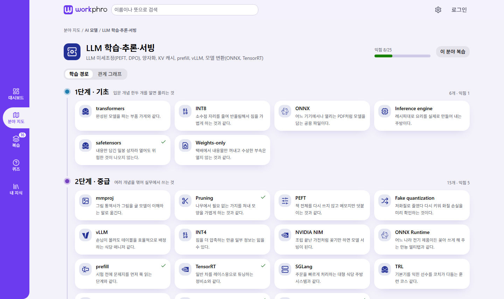
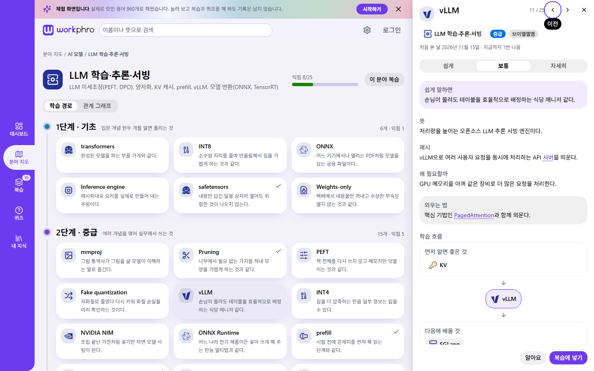
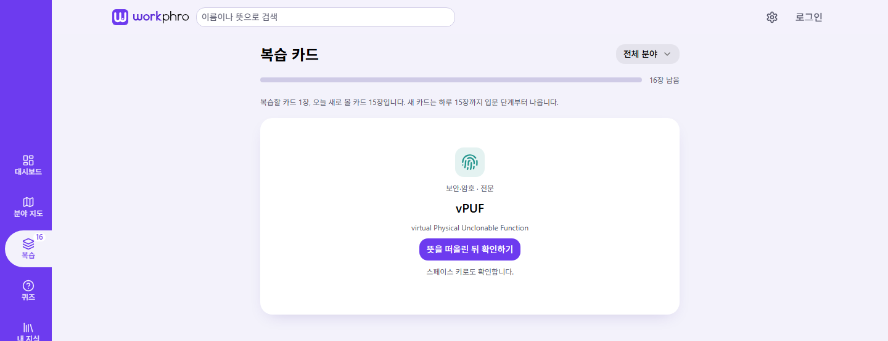
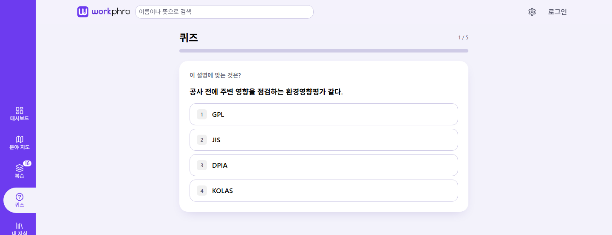

# phro-learn

**일하며 만난 용어를 내 지식으로.** Claude와 대화하다 스쳐 간 AI·IT 용어를 자동으로 모으는 Claude Code 플러그인입니다. 모은 용어는 웹 서비스 [workphro](https://work.phro.net)에서 쉬운 설명, 분야 지도, 복습 카드, 퀴즈로 익힙니다.



## 이렇게 씁니다

1. **설치**하면 Claude가 답을 마칠 때마다 처음 보는 용어를 골라 패널에 모읍니다. 따로 할 일은 없습니다.
2. **연결**하면(`/phro-learn login`, Google 계정) 모인 용어가 workphro로 갑니다. 여러 PC에서 모아도 계정 하나로 합쳐집니다.
3. **익히기**는 브라우저에서 합니다. 하루 10분, 새 용어 보기와 복습 카드, 퀴즈 세 단계입니다.

로그인하지 않아도 [work.phro.net](https://work.phro.net)에서 실제로 모인 용어 960개로 채운 체험 화면을 둘러볼 수 있습니다.

## workphro에서 보는 화면

| 분야 지도 | 분야 안의 학습 경로 |
|---|---|
|  |  |
| 내 용어가 어느 분야에 얼마나 있고 얼마나 익혔는지 한눈에 봅니다. | 한 분야의 용어를 입문부터 순서대로, 한 줄 비유와 함께 봅니다. |

**용어 카드.** 쉽게·보통·자세히 세 수준의 설명, 예문, 왜 필요한지, 먼저 알면 좋은 용어와 다음에 배울 용어가 한 장에 있습니다.



| 복습 카드 | 퀴즈 |
|---|---|
|  |  |
| 뜻을 떠올린 뒤 확인합니다. 잊을 즈음 다시 나옵니다. | 본 용어를 문제로 확인합니다. |

## 시작하기

Claude Code 터미널에서:

```bash
claude plugin marketplace add ThatsHoon/phro && claude plugin install phro-learn@phro
```

그다음 Claude Code에서:

```
/phro-learn          용어 패널 열기
/phro-learn login    workphro 연결 (브라우저에서 Google로 로그인하고 화면의 코드를 승인)
```

연결하지 않아도 패널은 이 PC 안에서 동작합니다(아래 "연결하지 않고 쓰기").

## 무엇을 보내나요

연결했을 때 workphro로 가는 것은 **용어 후보 낱말, 나온 횟수와 시각, 작업 폴더의 이름**입니다.

- 작업 폴더의 이름: Claude가 일하던 폴더의 이름 하나(`C:\work\shop-api`라면 `shop-api`)입니다. workphro가 용어마다 어느 프로젝트에서 나왔는지 보여 주는 데 쓰고, 계정의 키로 암호화해 둡니다. 홈 폴더나 그 위 폴더에서 연 세션은 보내지 않습니다. 플러그인 설정의 `project`를 `off`로 두면 이 PC에만 남습니다.
- 보내지 않는 것: 답변 원문, 용어가 나온 문장, 코드, 파일 경로, 세션 정보.
- 보내기 전에 낱말에서 거르는 것: 작업 폴더 경로의 각 이름, git remote의 소유자·저장소 이름, `package.json`·`pyproject.toml`의 이름, 키·토큰처럼 보이는 문자열, 프로젝트 루트 `.termboardignore`에 한 줄씩 적은 단어.
- 프로젝트 하나를 통째로 빼려면 그 루트의 `.termboardignore`에 `*` 한 줄을 둡니다.
- 패널의 **제거** 탭에 둔 용어는 다시 나와도 모으지 않고 보내지도 않습니다.

## 용어 패널

Claude 데스크톱 옆에 뜨는 체크리스트입니다. 용어마다 풀네임, 종류(개념, 기법, 지표, 모델, 도구, 표준, 조직), 한 문장 뜻, 처음 나온 답변 속 문장(`예)`)이 붙습니다.

- 탭: **배울 용어** → ☐ 누르면 **복습** → ☐ 누르면 **학습 완료**(☑ 누르면 복습으로 돌아감). 필요 없는 용어는 **제거** 탭으로 치우고 **복원**으로 되돌립니다.
- **검색**은 용어, 뜻, 예문, 다른 이름(풀네임, 한글 이름)에서 찾습니다. 대소문자와 띄어쓰기는 가리지 않습니다.
- **정렬**은 최신순, abc순, 가나다순(연결 언어가 다르면 그 언어의 이름순).
- 여러 세션이 같은 목록을 쓰고 3초마다 서로의 변경을 반영합니다.

## 명령

| 명령 | 동작 |
|---|---|
| `/phro-learn` | 패널 열기 |
| `/phro-learn login` | workphro 연결 |
| `/phro-learn logout` | 연결 해제. 이 PC의 연결 토큰을 서버에서 폐기하고 로컬 모드로 돌아갑니다 |
| `/phro-learn status` | 모드, 등급, 전송 대기 수, 마지막 동기화 |
| `/phro-learn sync` | 지금 보내고 용어집 변경분 받기 |
| `/phro-learn upload` | 연결 전에 이 PC에서 모은 용어를 올릴지 다시 묻기 |
| `/phro-learn scan` | 현재 세션의 지난 답변 전체에서 용어 다시 찾기 |
| `/phro-learn judge` | 판정 대기 중인 후보를 지금 판정(로컬 모드) |
| `/phro-learn stats` | 로컬 모드의 Haiku 호출 수와 토큰 사용량 |

**언어**: 설치할 때 `language` 옵션으로 ko, en, ja, de, es, fr, pt, it, id 중 하나를 고릅니다. 기본값 `account`는 workphro 계정의 언어를, 연결 전에는 시스템 언어를 따릅니다.

## 연결 관련 자주 묻는 것

- **여러 PC**: workphro의 용어집이 원본이고 PC마다 사본을 받습니다. 웹에서 지운 용어는 다음 동기화 때 PC에서도 지워집니다.
- **연결 전에 모은 용어**: 자동으로 올라가지 않습니다. 연결 뒤 패널이 한 번 묻고, **올리기**는 위의 거르기를 다시 거쳐 보내며, **두기**는 "이 PC만" 표시를 달아 남깁니다.
- **다른 계정으로 로그인**: 앞 계정의 용어는 이 PC에서 지워지고 새 계정 것을 받습니다.
- **연결 정보**: 연결 토큰은 플러그인 저장소에, 15분짜리 접근 토큰은 메모리에만 둡니다.

## 연결하지 않고 쓰기 (로컬 모드)

연결하지 않으면 용어는 `~/.claude/phro-learning/terms.json` 한 파일에 쌓이고, 판정은 이 PC의 Claude Code가 Haiku로 합니다. 연결하면 이 PC에서는 모델을 부르지 않습니다.

<details>
<summary>로컬 모드가 용어를 고르는 방법과 비용</summary>

1. **후보 추출**: 코드 블록, 인라인 코드, URL, 파일 경로를 먼저 걷어낸 뒤 약어(`API`, `CI/CD`)와 안에 대문자가 있는 이름(`LoRA`, `PyTorch`)을 뽑습니다. 한국어·일본어·중국어 답변에서는 문장 속 영어 표현을, 그 밖의 언어에서는 굵게 쓴 말을 더 뽑습니다. 저장소 이름, `--옵션`, `file.ts` 같은 토큰과 커밋 해시는 뺍니다.
2. **중복 거르기**: 소문자로 바꾸고 괄호, 공백, `-`, `_`, `.`를 지운 키로 비교합니다. 이미 모은 용어와 별칭, 여러 단어 용어의 머리글자(`Continuous Integration` → `ci`), 예전에 탈락한 단어와 겹치면 뺍니다. 중복 판단은 모두 로컬 파일로 합니다.
3. **모아서 판정**: 새 후보가 40개 차거나 가장 오래된 후보가 하루를 넘기면 후보 낱말만 번호를 붙여 Haiku에 한 번 보냅니다. 문장과 기존 용어 목록은 보내지 않습니다. Haiku는 주어진 후보 안에서 배울 만한 것만 최대 15개 고르고, 같은 대상은 하나로 합쳐 별칭을 붙입니다. 탈락한 낱말은 기록해 다시 보내지 않습니다.
4. **여러 세션**: 판정할 묶음을 대기열에서 먼저 빼 두므로 두 세션이 같은 묶음을 판정하지 않습니다. 호출이 실패하면 묶음을 되돌리고, 파일이 깨져 있으면 덮어쓰지 않고 알립니다.

비용은 후보 40개(또는 하루 치)마다 Haiku 호출 한 번입니다(출력 최대 4,000 토큰). 답변이 끝날 때는 후보를 대기열에 넣기만 하고 모델을 부르지 않으며, 용어가 쌓여도 호출당 토큰은 늘지 않습니다. 서브에이전트 턴과 중단·에러로 끝난 턴에서는 모으지 않습니다. 실제 사용량은 `/phro-learn stats`로 봅니다.

</details>

## 예전 이름에서 옮기기

0.15.0에서 이름이 phro-learning에서 phro-learn으로, 명령이 `/term-board`에서 `/phro-learn`으로 바뀌었습니다. 예전 이름으로 설치했다면 `claude plugin uninstall phro-learning@phro` 뒤 위 설치 명령을 다시 실행하고, 연결했었다면 `/phro-learn login`도 다시 합니다. 모은 용어는 `~/.claude/phro-learning/terms.json`에 그대로 남습니다.

## 라이선스

[MIT](LICENSE)
